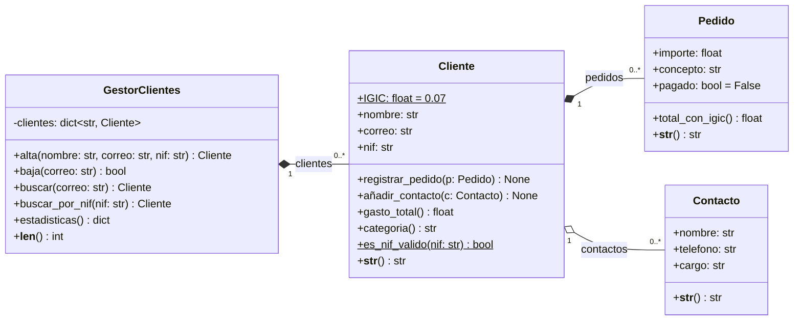

# Curso de especialización en Desarrollo de aplicaciones en lenguaje Python

- **Alumno/a:** Daniel Valencia Hernández
- **Usuario GitHub:** dvh793
- **Centro:** CIFP César Manrique

## 5100 · Programación orientada a objetos

| Carpeta | Unidad de trabajo |
|---------|-------------------|
| 5100/UT0 | Puesta en marcha y repaso de Python |
| 5100/UT1 | Fundamentos de la POO |
| 5100/UT2 | Clases avanzadas y organización del código |
| 5100/UT3 | Persistencia en ficheros y serialización |
| 5100/UT4 | Bases de datos y aplicaciones web |
| 5100/UT5 | Proyecto intermodular (pruebas y documentación) |

## 5101 · Análisis de datos con Python

| Carpeta | Unidad de trabajo |
|---------|-------------------|
| 5101/UT0 | Puesta en marcha y repaso de Python |
| 5101/UT1 | Carga, exportación y persistencia de datos |
| 5101/UT2 | Limpieza, normalización y estandarización de datos |
| 5101/UT3 | Análisis exploratorio y visualización |
| 5101/UT4 | Modelado y predicción |
| 5101/UT5 | Proyecto intermodular |

